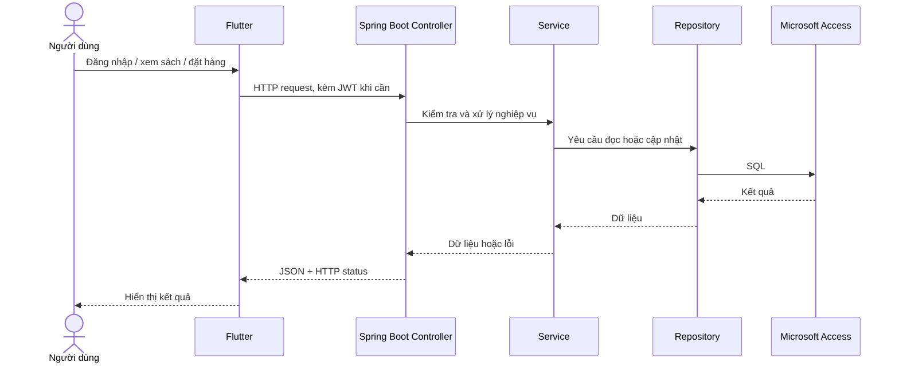

# Các luồng API của CoNangBookStore

API chạy tại `http://localhost:8080/api`. Frontend nằm trong `frontend/`, backend nằm trong `backend/`. Các luồng dưới đây mô tả mã đang được ứng dụng Flutter sử dụng.

## Tổng quan



### 1. Tạo tài khoản và đăng nhập

| Bước | API | Xử lý |
| --- | --- | --- |
| Tạo tài khoản | `POST /api/auth/register` | Kiểm tra dữ liệu, tránh trùng username/email, mã hóa mật khẩu BCrypt rồi lưu vào `Users`. Không cần JWT. |
| Đăng nhập | `POST /api/auth/login` | Tìm tài khoản, kiểm tra mật khẩu và trạng thái, trả JWT trong `accessToken`. Không cần JWT. |
| Xem phiên hiện tại | `GET /api/auth/me` | Đọc `userId`, `username`, `role` từ JWT. Cần JWT. |

Ví dụ body đăng nhập:

```json
{"username":"demo_user","password":"DemoPass123!"}
```

Frontend gọi từ `frontend/lib/services/auth_service.dart`, lưu `accessToken` bằng `shared_preferences`. `frontend/lib/services/api_client.dart` gửi `Authorization: Bearer <token>` cho các request cần đăng nhập. Backend giải mã JWT trong `SecurityConfig`, còn `AuthController` → `AuthService` → `AuthRepository` xử lý đăng nhập. JWT mặc định hết hạn sau 900 giây theo cấu hình API.

### 2. Xem và quản lý sách

| API | Ai được gọi | Ý nghĩa |
| --- | --- | --- |
| `GET /api/books` | Mọi người | Lấy danh sách; hỗ trợ `keyword`, `isbn`, `categoryId`, `minPrice`, `maxPrice`, `minStock`, `maxStock`, `status`. |
| `GET /api/books/{id}` | Mọi người | Lấy chi tiết một sách. |
| `GET /api/categories` | Mọi người | Lấy danh mục. |
| `POST /api/books` | STAFF, ADMIN | Thêm sách. |
| `PUT /api/books/{id}` | STAFF, ADMIN | Cập nhật sách. |
| `DELETE /api/books/{id}` | ADMIN | Xóa sách. |

Trong app: `home_page.dart` → `frontend/lib/services/book_service.dart` → `GET /api/books` → `BookController` → `BookService` → `BookRepository` → bảng `Books`. API trả JSON để Flutter hiển thị. Sách không có trạng thái `ACTIVE` hoặc hết tồn kho sẽ không thể thêm vào giỏ để đặt hàng.

### 3. Giỏ hàng

Thêm sách, đổi số lượng và xóa khỏi giỏ được xử lý trong `frontend/lib/services/cart_store.dart`. Giỏ hàng được lưu theo `userId` bằng `shared_preferences`; **giai đoạn này không gọi API tạo đơn và chưa trừ tồn kho**. Frontend kiểm tra tồn kho đang hiển thị để hỗ trợ người dùng, backend sẽ kiểm tra lại khi đặt hàng.

### 4. Đặt hàng và trừ tồn kho

`home_page.dart` → `frontend/lib/services/order_service.dart` → `POST /api/orders` kèm JWT. Ví dụ body:

```json
{
  "status": "PENDING",
  "shippingAddress": "123 Đường A, Hà Nội",
  "phone": "0900000000",
  "note": "Giao giờ hành chính",
  "items": [{"bookid": 2, "quantity": 1}]
}
```

Backend xử lý trong `OrderController` → `OrderService` → `OrderRepository`:

1. Xác định người mua từ JWT; kiểm tra đơn có ít nhất một sách, ID sách không lặp, sách tồn tại và có trạng thái `ACTIVE`.
2. Đọc **giá và tồn kho hiện tại từ Access**, tự tính tổng tiền. Giá và tổng tiền không lấy từ frontend.
3. Trừ tồn kho bằng câu `UPDATE` có điều kiện `StockQuantity >= quantity` và `Status = 'ACTIVE'`. Nếu người khác vừa mua hết sách, cập nhật không thành công và đơn bị từ chối.
4. Lưu `Orders` với trạng thái `PENDING`, lưu `OrderItems` và `OrderStatusHistory` trong giao dịch. Thành công trả HTTP `201` và `orderId`.
5. Flutter chỉ xóa giỏ sau khi API báo thành công, rồi tải lại sách và đơn hàng.

### 5. Xem và xử lý đơn hàng

| API | Quyền | Luồng |
| --- | --- | --- |
| `GET /api/orders/my-orders` | Đã đăng nhập | Lấy các đơn thuộc tài khoản trong JWT. |
| `GET /api/orders/{id}` | Chủ đơn | Xem chi tiết đơn. |
| `GET /api/orders/{id}/items` | Chủ đơn | Xem các sách trong đơn. |
| `GET /api/orders/{id}/history` | Chủ đơn | Xem lịch sử trạng thái. |
| `POST /api/orders/{id}/cancel` | Chủ đơn | Hủy đơn `PENDING` hoặc `APPROVED`; hoàn kho nếu đã trừ. |
| `POST /api/orders/{id}/approve` | STAFF, ADMIN | Duyệt đơn `PENDING` → `APPROVED`. |
| `POST /api/orders/{id}/reject` | STAFF, ADMIN | Từ chối đơn `PENDING` → `REJECTED`; hoàn kho nếu đã trừ. |
| `POST /api/orders/{id}/ship` | STAFF, ADMIN | Chuyển `APPROVED` → `SHIPPING`. |
| `POST /api/orders/{id}/complete` | STAFF, ADMIN | Chuyển `SHIPPING` → `COMPLETED`. |

Màn hình Flutter hiện gọi `my-orders` và `/{id}/items`. Các API duyệt, từ chối, giao hàng và hoàn thành đã có ở backend nhưng chưa có màn hình quản trị tương ứng trong Flutter. Backend kiểm tra quyền sở hữu đơn ở `OrderService`, kiểm tra trạng thái trước khi đổi và ghi lịch sử thay đổi.

## Cách trả lời nhanh khi được hỏi

- **Token lưu ở đâu?** Frontend lưu JWT trong `shared_preferences`, API xác thực qua header `Authorization: Bearer <token>`.
- **Giỏ hàng có ở database không?** Không. Giỏ hàng lưu cục bộ theo tài khoản; chỉ khi đặt thành công mới tạo đơn trong Access.
- **Ai quyết định giá tiền?** Backend đọc giá trong bảng `Books` và tự tính tổng, nên frontend không thể tự gửi giá để thay đổi tiền đơn.
- **Nhiều người mua cùng cuốn sách thì sao?** Backend trừ kho bằng `UPDATE` có điều kiện số lượng còn đủ; khi không đủ, API báo lỗi thay vì tạo đơn vượt tồn kho.
- **Sách ngừng kinh doanh có đặt được không?** Không. Backend chỉ nhận sách có trạng thái `ACTIVE`; frontend cũng chặn thao tác thêm vào giỏ.
